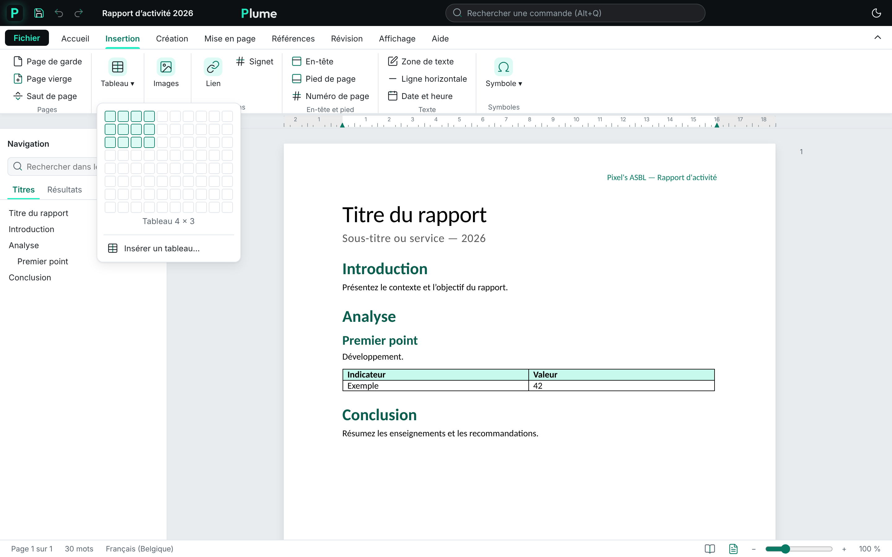
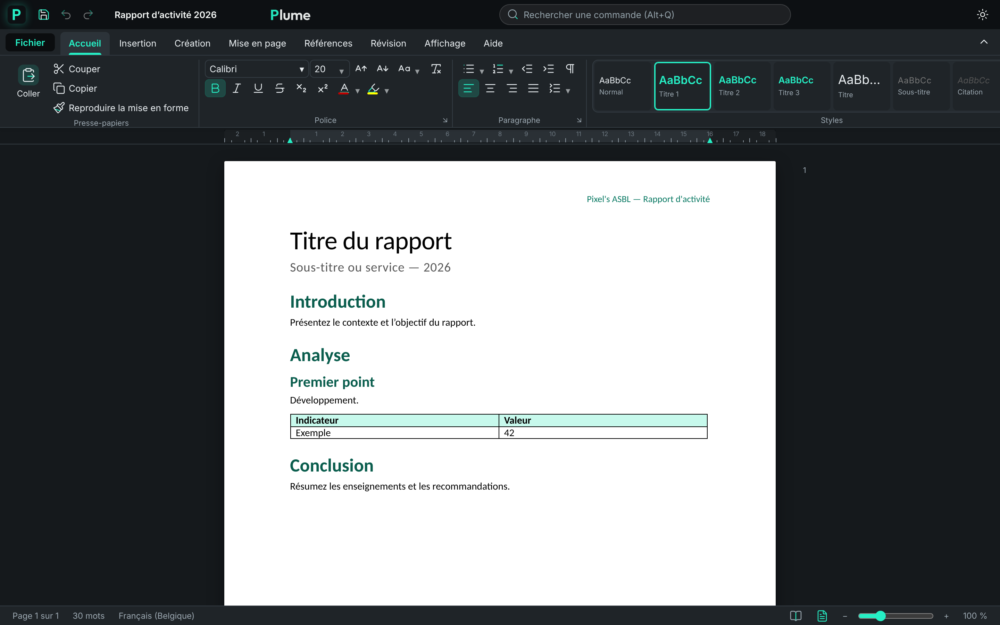
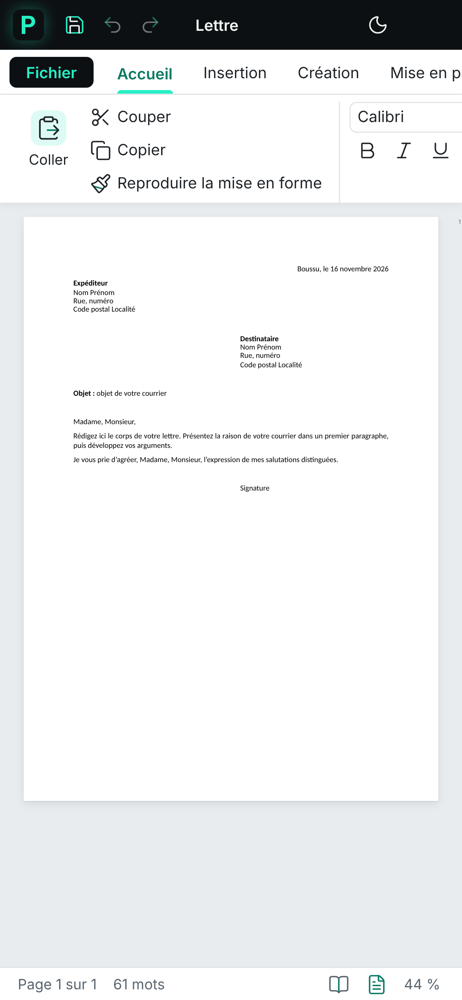

<div align="center">

<picture>
  <source media="(prefers-color-scheme: dark)" srcset="icons/plume-wordmark-light.svg">
  
</picture>

**Le traitement de texte de Pixel's ASBL : libre d'usage, hors ligne et compatible Word (.docx)**


-26EFC5?style=flat-square&labelColor=0D1013)

-26EFC5?style=flat-square&labelColor=0D1013)

### [▶ Ouvrir Plume : **plume.asblpixels.be**](https://plume.asblpixels.be)

<sub>Adresse de secours : https://asblpixels.github.io/Plume/</sub>


</div>

---

## Télécharger Plume

| Plateforme | Version | Comment l'obtenir |
|---|---|---|
| 🌐 **Navigateur** (tous systèmes) | En ligne | **https://plume.asblpixels.be** : rien à installer |
| 🪟 **Windows 10 / 11** | Installateur | `Plume-Setup-1.3.0-x64.exe` (page *Releases*) |
| 🪟 **Windows** (sans installation) | Portable | `Plume-Portable-1.3.0-x64.zip` (page *Releases*) : décompresser, lancer `Plume.exe` |
| 🐧 **Linux** | AppImage, .deb, .rpm | `Plume-1.3.0.AppImage`, `plume_1.3.0_amd64.deb`, `plume-1.3.0.x86_64.rpm` |
| 🐧 **Linux** (Flatpak, Snap) | `Plume.flatpak`, `plume_*.snap` | `flatpak install Plume.flatpak` · `sudo snap install --dangerous plume_*.snap` |
| 🤖 **Android** | APK | `Plume-*-android.apk` : ouvrir le fichier sur le téléphone, autoriser « sources inconnues » ; ou application web : Chrome → ⋮ → **Installer l'application** |
| 🍎 **iPhone / iPad** | Application d'écran d'accueil | Ouvrir l'adresse en ligne dans Safari → Partager → **Sur l'écran d'accueil** (recommandé). Un `.ipa` non signé est aussi fourni pour AltStore / Sideloadly. |

---

## Sommaire

1. [Présentation](#présentation)
2. [Captures d'écran](#captures-décran)
3. [Fonctionnalités](#fonctionnalités)
4. [Compatibilité .docx](#compatibilité-docx)
5. [Installation et lancement](#installation-et-lancement)
6. [Installer Plume comme une application](#installer-plume-comme-une-application)
7. [Déploiement en production](#déploiement-en-production)
8. [Navigateurs pris en charge](#navigateurs-pris-en-charge)
9. [Raccourcis clavier](#raccourcis-clavier)
10. [Architecture technique](#architecture-technique)
11. [Guide du développeur](#guide-du-développeur)
12. [Tests et assurance qualité](#tests-et-assurance-qualité)
13. [Sécurité, vie privée et RGPD](#sécurité-vie-privée-et-rgpd)
14. [Feuille de route](#feuille-de-route)
15. [Historique des versions](#historique-des-versions)
16. [Licence et crédits](#licence-et-crédits)
17. [Contact](#contact)

---

## Présentation

Plume est un traitement de texte complet qui s'exécute entièrement dans le navigateur. Il a été conçu par **Pixel's ASBL** (Boussu, Belgique) pour trois usages :

- offrir à nos bénéficiaires un outil **gratuit**, **sans compte** et **sans abonnement** ;
- permettre d'**ouvrir et de renvoyer des documents Word** reçus de l'administration, d'un employeur ou d'une école ;
- servir de **support de formation** : l'organisation de l'interface est celle des traitements de texte du marché, ce qui facilite le passage de l'un à l'autre.

| Principe | Mise en œuvre |
|---|---|
| **Familiarité** | Menu Fichier, ruban à onglets, galerie de styles, règle, barre d'état et raccourcis standards : un habitué s'y retrouve immédiatement. |
| **Compatibilité** | Lecture et écriture natives du format Office Open XML (`.docx`), sans conversion par un service tiers. |
| **Autonomie** | Aucun serveur applicatif, aucune base de données. Fonctionne hors ligne après la première visite. |
| **Confidentialité** | Les documents ne quittent jamais l'appareil. |
| **Accessibilité matérielle** | Tourne sur de vieux PC comme sur les téléphones, sous tous les systèmes d'exploitation. |
| **Sobriété** | Deux bibliothèques libres seulement (JSZip, PDF.js). Pas de framework, pas de compilation. |

> Plume est un logiciel indépendant, sans aucun lien avec Microsoft Corporation. « Microsoft Word » et « Office 365 » sont des marques de Microsoft Corporation. L'identité visuelle de Plume (nom, logo, couleurs, icônes) lui est propre.

---

## Captures d'écran

| Fenêtre principale | Ruban Insertion et volet de navigation |
|---|---|
|  |  |
| **Thème sombre** | **Menu Fichier (modèles et documents récents)** |
|  |  |

<p align="center"><b>Sur téléphone</b><br></p>

---

## Fonctionnalités

### Fichier
| Fonction | Détail |
|---|---|
| Nouveau | Document vierge ou modèle : **Lettre**, **Curriculum vitae**, **Rapport**, **Compte rendu de réunion** |
| Ouvrir | `.docx`, `.html`, `.txt`, `.md` ; glisser-déposer d'un fichier dans la fenêtre ; documents récents |
| Enregistrer | `.docx`. Sous Chrome et Edge, **Ctrl+S réécrit directement le fichier d'origine** (File System Access API). Ailleurs, le fichier est téléchargé. |
| Enregistrement automatique | Chaque modification est sauvegardée dans le navigateur (IndexedDB). Le dernier document est rouvert au démarrage. |
| Exporter | PDF (via l'impression), page web `.html` autonome (images incluses), texte brut `.txt` |
| Imprimer | Respect du format, des marges, de l'en-tête et du pied de page |
| Informations | Titre, auteur, nombre de pages, de mots et de caractères, format de page |

### Accueil
| Groupe | Commandes |
|---|---|
| Presse-papiers | Coller, Couper, Copier, Reproduire la mise en forme |
| Police | Police (aperçu dans le menu), taille, agrandir et réduire, modifier la casse (5 modes), gras, italique, souligné, barré, indice, exposant, couleur de police (palette et nuancier libre), surlignage, effacer la mise en forme, boîte de dialogue **Police** complète |
| Paragraphe | Puces (rond, cercle, carré, tiret), numérotation (1., a., A., i., I.), niveaux de liste, retraits, 4 alignements, interligne (1,0 à 3,0), espacement avant et après, marques de paragraphe ¶, boîte de dialogue **Paragraphe** |
| Styles | Normal, Titre 1, Titre 2, Titre 3, Titre, Sous-titre, Citation, Code |
| Modification | Rechercher (surlignage de tous les résultats), Remplacer / Remplacer tout (casse, mot entier), Sélectionner tout |

### Insertion
Page de garde · Page vierge · Saut de page · **Tableau** (grille 10 × 8 ou dialogue) · **Images** (fichier, glisser-déposer, coller ; redimensionnement à la souris) · Lien · Signet · **En-tête** et **pied de page** répétés sur chaque page · **Numéro de page** (« X » ou « Page X sur Y ») · Zone de texte · Ligne horizontale · Date et heure (6 formats) · Symboles (€, ©, flèches, lettres grecques…).

### Création
Police du document · Espacement des paragraphes (Compact, Normal, Aéré, Ouvert, Double) · Couleur des titres · Page sombre (affichage uniquement).

### Mise en page
Marges (Normales 2,5 cm, Étroites, Modérées, Larges, ou personnalisées) · Orientation portrait ou paysage · Taille (A4, A5, A3, Lettre, Légal, B5 ou personnalisée) · Retraits et espacements chiffrés du paragraphe · **Marges ajustables à la souris sur la règle**.

### Références
**Table des matières** générée à partir des titres, avec numéros de page. Elle est exportée comme un vrai champ TOC, que Word met à jour à l'ouverture. **Notes de bas de page** : numérotation automatique, affichage en bas de page, modification au clic.

### Révision
**Commentaires** (nouveau, modifier, supprimer, volet Commentaires, surlignage du passage commenté) · **Suivi des modifications** (affichage des insertions et suppressions, accepter tout, refuser tout, affichage « Final ») · Vérification orthographique (dictionnaire du navigateur ou du système) · Langue du document (FR-BE, FR-FR, NL-BE, EN-GB, EN-US, DE, ES, IT, AR) · Statistiques · **Lecture à voix haute** du document ou de la sélection.

### Affichage
Mode Lecture · Plein écran · Règle · **Volet de navigation** (plan des titres cliquable et résultats de recherche avec extraits) · Zoom de 25 à 300 % (100 %, Une page, Largeur de la page, Ctrl+molette) · Thème clair ou sombre (le choix du système est suivi par défaut).

### Tableau (onglet contextuel)
Il apparaît dès que le curseur entre dans un tableau : insérer une ligne au-dessus ou en dessous, une colonne à gauche ou à droite · supprimer une ligne, une colonne ou le tableau · fusionner, fractionner · bordures · trame de fond · ligne d'en-tête répétée · uniformiser les colonnes. **Tab** passe à la cellule suivante et crée une ligne à la fin du tableau.

### Publipostage
Lettres et documents personnalisés à partir d'un fichier **CSV** (export de tableur) : choix des destinataires, insertion de champs « Nom », « Adresse »…, aperçu destinataire par destinataire, puis fusion en un document unique (un exemplaire par destinataire, séparés par des sauts de page), prêt à imprimer ou à exporter.

### Polices scolaires et cursives
Plume intègre des polices libres pensées pour l'école et l'accessibilité :

| Police | Usage |
|---|---|
| **Playwrite FR Moderne** | Cursive scolaire française (écriture attachée) |
| **Playwrite FR Trad** | Cursive française traditionnelle |
| **Andika** | Apprentissage de la lecture (lettres sans ambiguïté) |
| **OpenDyslexic** | Lecteurs dyslexiques |
| **Comic Neue** | Écriture manuscrite simple |
| **Atkinson Hyperlegible** | Personnes malvoyantes |
| **Lexend** | Lisibilité, fatigue visuelle |

**Ajouter une police** (par exemple **Marelle**, ou toute police d'école) : liste des polices → **« Ajouter une police… »**, ou onglet **Création → Ajouter une police**. Tout fichier `.ttf`, `.otf`, `.woff` ou `.woff2` est accepté. La police reste disponible à chaque ouverture de Plume sur cet appareil. **Création → Mes polices** permet de les retirer.

> Vérifiez la licence d'une police avant de la diffuser. Un document envoyé au **format PDF** contient toujours la police ; au format Word, l'ordinateur du destinataire doit avoir la police installée.

### Outils d'écriture
- **Suivi des modifications en direct** (`Ctrl+Maj+E`) : chaque ajout et chaque suppression est marqué avec l'auteur et la date, puis exporté comme vraies révisions Word.
- **Correction automatique de la typographie française** : guillemets « », apostrophe ’, espaces fines insécables avant ; : ! ?, tiret demi-cadratin (--), © ; peut être désactivée dans l'onglet Révision.
- **Dictée vocale** (Accueil → Dicter) : « virgule », « point », « nouvelle ligne » sont reconnus.
- **Légendes numérotées** (Figure 1, Tableau 2…) avec renumérotation automatique.
- **Filigrane** (CONFIDENTIEL, BROUILLON…) à l'écran, à l'impression et dans le PDF.
- **Restreindre la modification** : passage du document en lecture seule.

### Ergonomie
- **Recherche de commandes** (`Alt+Q`) : tapez « marge », « puce » ou « pdf » pour lancer la commande sans chercher dans le ruban.
- **Mini barre flottante** au-dessus d'une sélection de texte.
- **Pagination visuelle** en pages A4 réelles, avec numéro de page courante dans la barre d'état.
- **Annuler / Rétablir** sur 300 niveaux, y compris pour les opérations sur les tableaux, la mise en page et les en-têtes.
- Ruban repliable (`Ctrl+F1`) et interface adaptée aux écrans tactiles et aux petits écrans.

---

## Formats de fichiers

### Ouvrir

| Format | Extensions | Application d'origine | Prise en charge |
|---|---|---|---|
| Word | `.docx` `.docm` `.dotx` `.dotm` | Microsoft 365, Word 2007+ | ✅ Complète, avec conservation intégrale (voir plus bas) |
| Word 97-2003 | `.doc` `.dot` | Word 97 à 2003 | ✅ Texte, paragraphes, tableaux ; **mise en forme complète** dans l'application de bureau avec LibreOffice |
| OpenDocument | `.odt` `.ott` `.fodt` | LibreOffice, OpenOffice, Google Docs, Collabora | ✅ Styles, listes, tableaux, images, en-têtes, notes, commentaires, mise en page |
| Google Docs | `.docx` / `.odt` téléchargés | Google Docs (*Fichier → Télécharger*) | ✅ ; un raccourci `.gdoc` affiche la marche à suivre |
| Texte enrichi | `.rtf` | WordPad, TextEdit, tous traitements de texte | ✅ Mise en forme, tableaux, images, liens, notes, en-têtes |
| PDF | `.pdf` | Tous | ✅ Texte et structure (titres, paragraphes, pages) ; mise en page simplifiée |
| Markdown | `.md` `.markdown` | Éditeurs, wikis, GitHub | ✅ Titres, listes imbriquées, tableaux, citations, code, liens, images |
| Page web | `.html` `.htm` `.xhtml` | Navigateurs, éditeurs web | ✅ Contenu nettoyé (scripts supprimés) |
| Texte / données | `.txt` `.csv` | Bloc-notes, tableurs | ✅ Encodage détecté (UTF-8, UTF-16, Windows-1252) ; CSV converti en tableau |
| Autres | `.wpd` `.wps` `.pages` `.sxw` `.abw` `.lwp` `.hwp` `.wri` `.xml` (Word 2003)… | WordPerfect, Works, Apple Pages, OpenOffice 1, AbiWord, Lotus… | ✅ Application de bureau avec **module de conversion LibreOffice** |

Plume reconnaît un fichier à son contenu et pas seulement à son extension : un `.doc` qui est en réalité un `.docx` ou un `.rtf` s'ouvre correctement.

### Enregistrer et exporter

| Format | Remarque |
|---|---|
| Word (`.docx`) | Format par défaut ; conservation intégrale des documents Word ouverts |
| OpenDocument (`.odt`) | Validé par ouverture dans LibreOffice |
| PDF (`.pdf`) | Fichier PDF réel dans l'application de bureau (avec signets) ; impression « Enregistrer au format PDF » dans le navigateur |
| Texte enrichi (`.rtf`) | Lisible par tous les traitements de texte |
| Word 97-2003 (`.doc`) | Application de bureau avec LibreOffice |
| Page web (`.html`), Markdown (`.md`), texte (`.txt`) | |

**Ctrl+S réenregistre dans le format d'origine** quand c'est possible (`.docx`, `.odt`, `.rtf`, `.md`, `.txt`, `.html`, et `.doc` dans l'application de bureau). Un PDF ou un format ancien ouvert est enregistré en `.docx`.

## Compatibilité .docx

Plume lit et écrit directement le format **Office Open XML** (ISO/IEC 29500). Les fichiers produits sont reconnus par Microsoft Word 2007 et suivants (dont Microsoft 365), LibreOffice, Google Docs, Pages et OnlyOffice.

### Conservation intégrale

Quand un document vient d'un fichier `.docx`, Plume garde en mémoire le paquet d'origine et applique trois règles :

1. **Ce que Plume sait éditer** (texte, styles, listes, tableaux, images en ligne, en-têtes…) est réécrit à partir du document modifié.
2. **Ce que Plume ne sait pas éditer** (graphiques, SmartArt, formes, zones de texte, images flottantes, objets OLE, images EMF/WMF, équations) devient un *îlot* : un aperçu fidèle est affiché, et le XML d'origine est **réécrit à l'identique**, avec toutes les parties qu'il référence (données du graphique, classeur Excel incorporé, images…).
3. **Les définitions du document** (styles personnalisés, numérotations, thème, polices, réglages de compatibilité, en-têtes de première page et de pages paires, colonnes, bordures de page, numérotation des lignes) sont **reprises depuis le fichier d'origine**. Plume n'ajoute que ce qui manque.

Résultat : un document ouvert puis réenregistré par Plume se rouvre dans Word avec ses graphiques, ses styles et sa mise en page d'origine, y compris les éléments que Plume ne sait pas modifier.

### Éléments pris en charge

| Élément | Lecture | Écriture | Remarques |
|---|:---:|:---:|---|
| Styles de paragraphe (Normal, Titres 1-6, Titre, Sous-titre, Citation) | ✅ | ✅ | Les styles Word sont générés à partir de l'aspect réel dans Plume |
| Police, taille, gras, italique, souligné, barré, couleur | ✅ | ✅ | |
| Surlignage et trame de caractère | ✅ | ✅ | |
| Exposant, indice, majuscules, petites majuscules, espacement des caractères | ✅ | ✅ | |
| Polices et couleurs du thème Office | ✅ | — | Résolues en valeurs explicites |
| Alignement, retraits, première ligne, retrait suspendu | ✅ | ✅ | |
| Espacement avant/après, interligne (multiple ou exact) | ✅ | ✅ | |
| Bordures et trame de paragraphe | ✅ | ✅ | |
| Listes à puces et numérotées, 9 niveaux, reprise de numérotation | ✅ | ✅ | |
| Tableaux, largeurs de colonnes, fusions horizontales et verticales | ✅ | ✅ | |
| Trame et alignement vertical des cellules, ligne d'en-tête répétée | ✅ | ✅ | |
| Images en ligne PNG, JPEG, GIF | ✅ | ✅ | WebP, SVG et BMP convertis en PNG à l'export |
| Liens hypertextes (externes et internes) et signets | ✅ | ✅ | |
| En-tête et pied de page, champs PAGE / NUMPAGES | ✅ | ✅ | |
| Notes de bas de page et de fin | ✅ | ✅ | Les notes de fin deviennent des notes de bas de page |
| Table des matières (champ TOC) | ✅ | ✅ | Mise à jour automatique à l'ouverture dans Word |
| Sauts de page, sauts de section | ✅ | ✅ | |
| Format, orientation, marges de page | ✅ | ✅ | |
| Propriétés (titre, auteur, dates) | ✅ | ✅ | |
| **Graphiques** (barres, lignes, secteurs…) | ✅ aperçu | ✅ à l'identique | Données et classeur incorporé conservés |
| **SmartArt** | ✅ aperçu | ✅ à l'identique | |
| **Formes, zones de texte, groupes** | ✅ aperçu | ✅ à l'identique | |
| **Images flottantes** (habillage) | ✅ flottantes à l'écran | ✅ position et habillage d'origine | |
| **Équations** (OMML) | ✅ aperçu (exposants, indices, fractions, racines) | ✅ à l'identique | |
| Objets OLE, images EMF/WMF | ✅ aperçu ou repère | ✅ à l'identique | |
| **Commentaires** | ✅ | ✅ | Ajout, modification, suppression, volet dédié |
| **Suivi des modifications** (insertions, suppressions) | ✅ | ✅ | Accepter / refuser tout, affichage « Final » |
| Styles personnalisés du document | ✅ | ✅ | `styles.xml` d'origine conservé |
| Numérotations personnalisées | ✅ | ✅ | `numbering.xml` d'origine conservé |
| Thème, table des polices, réglages de compatibilité | — | ✅ | Repris depuis le fichier d'origine |
| En-tête/pied de **première page**, pages paires | ✅ (1re page affichée) | ✅ à l'identique | |
| Colonnes, bordures de page, numérotation des lignes | — | ✅ à l'identique | Affichage sur une colonne dans Plume |
| Contrôles de contenu, champs complexes | ✅ | — | Le contenu est conservé |

### Limites connues

Aucun logiciel tiers n'atteint 100 % de compatibilité avec Word. Voici ce qui reste perfectible dans Plume :

| Élément | Comportement actuel |
|---|---|
| Contenu des îlots (graphiques, SmartArt, formes, équations) | Conservé et réécrit à l'identique, mais **non modifiable dans Plume** (déplacement et suppression possibles) |
| Nouvelles modifications | Le suivi des modifications existantes est géré ; l'**enregistrement de nouvelles révisions** n'est pas encore disponible |
| Réponses aux commentaires, commentaires « résolus » | Importés comme commentaires simples |
| Colonnes multiples | Conservées dans le fichier, affichées sur une colonne |
| Plusieurs sections avec des mises en page différentes | La mise en page de la dernière section s'applique à l'affichage ; les sauts de section sont convertis en sauts de page |
| Styles de tableau conditionnels (bandes, première colonne) | Seules les bordures et trames explicites sont reprises |
| Macros (`.docm`) | Ouvertes sans les macros, qui ne sont jamais exécutées |
| Ancien format `.doc` (Word 97-2003) | Non pris en charge : convertir d'abord en `.docx` |

> **Pagination.** Plume découpe les pages paragraphe par paragraphe : un paragraphe n'est jamais coupé entre deux pages. L'affichage peut donc différer de quelques lignes de celui de Word, qui coupe à la ligne. Le fichier `.docx` exporté est repaginé normalement par Word.

---

## Installation et lancement

### En ligne, sans installation

Plume est disponible à l'adresse **https://plume.asblpixels.be**. Aucun compte n'est nécessaire et les documents restent sur votre appareil. Depuis cette adresse, Plume peut aussi être installé comme une application (voir plus bas).

### En local

Plume est un ensemble de **fichiers statiques**. Il suffit de les servir en HTTP.

### Fedora Linux

```bash
# Récupérer le projet
git clone https://github.com/asblPixels/plume.git
cd plume

# Lancer un serveur local
python3 -m http.server 8080
```

Ouvrez **http://localhost:8080**.

Navigateur recommandé (installation en application et enregistrement direct dans le fichier) :

```bash
sudo dnf install chromium
# ou, via Flathub :
flatpak install flathub org.chromium.Chromium
```

Polices métriquement compatibles avec Calibri, Cambria, Arial et Times New Roman, pour une mise en page fidèle des documents Office :

```bash
sudo dnf install google-carlito-fonts google-caladea-fonts liberation-fonts
```

### Autres systèmes

| Système | Commande |
|---|---|
| Debian / Ubuntu | `sudo apt install python3 fonts-crosextra-carlito fonts-crosextra-caladea fonts-liberation` puis `python3 -m http.server 8080` |
| macOS | `python3 -m http.server 8080` (Python est fourni avec les outils Xcode) |
| Windows | `py -m http.server 8080` dans le dossier du projet |
| Node.js (tout système) | `npx serve .` |

> ⚠️ N'ouvrez pas `index.html` par un double-clic. Avec une adresse `file://`, le mode hors ligne et l'installation sont désactivés par les navigateurs.

---

## Application Windows (et Linux) à installer

Pour les postes sans connexion ou les utilisateurs qui préfèrent un programme classique, Plume existe aussi en **application de bureau** (dossier `desktop/`, basée sur Electron) :

| Fichier | Usage |
|---|---|
| `Plume-Setup-1.3.0-x64.exe` | Installateur Windows 10/11 **sans droits administrateur** : raccourcis Bureau et menu Démarrer, Plume proposé dans « Ouvrir avec » pour `.docx`, `.doc`, `.odt`, `.rtf`, `.pdf`…, désinstallation depuis *Paramètres → Applications* |
| `Plume-Portable-1.3.0-x64.zip` | Version portable : décompresser puis lancer `Plume.exe`, aucun droit administrateur, fonctionne depuis une clé USB |

Dans l'application de bureau :
- un double-clic sur un `.docx` dans l'Explorateur l'ouvre dans Plume (une seule fenêtre, même pour plusieurs fichiers) ;
- **Ctrl+S** réenregistre directement le fichier d'origine ;
- la vérification orthographique française est intégrée ;
- les liens s'ouvrent dans le navigateur par défaut.

> Les exécutables ne sont pas signés numériquement : au premier lancement, Windows SmartScreen affiche « Windows a protégé votre ordinateur ». Cliquez sur **Informations complémentaires → Exécuter quand même**.

### Compiler l'application de bureau (Fedora)

```bash
sudo dnf install nodejs mingw32-nsis   # NSIS : installateur Windows
cd desktop
npm install
npm run dist:win      # sous Windows : installateur et version portable
# sous Linux, sans Wine : application Windows + installateur NSIS natif
npx electron-builder --win dir --x64
makensis -DSEP=/ -DVERSION=1.3.0 -DSRC=$PWD/dist/win-unpacked -DOUT=$PWD/dist/Plume-Setup-1.3.0-x64.exe -DICON=$PWD/build/icon.ico installer/plume.nsi
npm run dist:linux    # → AppImage et paquet .rpm pour Fedora
npm start             # lancer l'application en mode développement
```

## Installer Plume comme une application

Plume est une **Progressive Web App (PWA)**. Une fois installée, elle a son icône, sa propre fenêtre sans barre d'adresse et fonctionne sans connexion.

| Plateforme | Navigateur | Procédure |
|---|---|---|
| **Linux** | Chromium, Chrome, Edge | Icône ⊕ « Installer » dans la barre d'adresse |
| **Windows** | Edge, Chrome | Icône « Installer l'application » dans la barre d'adresse → Plume apparaît dans le menu Démarrer |
| **macOS** | Chrome, Edge ; Safari 17+ | Chrome : icône d'installation ; Safari : *Fichier → Ajouter au Dock* |
| **Android** | Chrome, Edge, Samsung Internet | Menu ⋮ → *Installer l'application* |
| **iPhone / iPad** | Safari | Bouton *Partager* → *Sur l'écran d'accueil* |

Sur ordinateur, l'application installée s'enregistre comme **gestionnaire des fichiers `.docx`** : clic droit sur un document → *Ouvrir avec → Plume*.

> L'installation exige une connexion sécurisée **HTTPS** (ou `localhost`).

---

## Déploiement en production

Pour mettre Plume à disposition des bénéficiaires, hébergez le dossier sur n'importe quel serveur web en HTTPS. Aucun traitement côté serveur n'est nécessaire.

### Nginx

```nginx
server {
    listen 443 ssl http2;
    server_name plume.asblpixels.be;
    root /var/www/plume;
    index index.html;

    # Types MIME
    types { application/manifest+json webmanifest; }
    include mime.types;

    # Le service worker ne doit jamais être mis en cache
    location = /sw.js { add_header Cache-Control "no-cache"; }

    # En-têtes de sécurité
    add_header Content-Security-Policy "default-src 'self'; img-src 'self' data: blob:; style-src 'self' 'unsafe-inline'; script-src 'self'; connect-src 'self' blob: data:" always;
    add_header X-Content-Type-Options nosniff always;
    add_header Referrer-Policy no-referrer always;
}
```

### Apache (`.htaccess`)

```apache
AddType application/manifest+json .webmanifest
<Files "sw.js">
  Header set Cache-Control "no-cache"
</Files>
```

### Hébergements statiques

| Service | Remarque |
|---|---|
| GitHub Pages | **Version officielle** : https://plume.asblpixels.be (publiée depuis la branche `main`) |
| Netlify, Cloudflare Pages | Glisser-déposer du dossier, HTTPS automatique |
| Serveur de l'ASBL | Configuration Nginx ou Apache ci-dessus |

### Mise à jour des postes

À chaque nouvelle version, incrémentez la constante `CACHE` dans `sw.js` (par exemple `plume-v2`). Les applications installées récupèrent la mise à jour au lancement suivant.

---

## Compilation automatique

Chaque envoi sur `main` déclenche la compilation (onglet **Actions** du dépôt). La publication d'un **tag `vX.Y.Z`** fabrique et joint automatiquement à la Release :

| Plateforme | Fichier | Fabriqué par |
|---|---|---|
| Windows | installateur `.exe` + portable `.zip` | Electron + NSIS (`desktop/installer/plume.nsi`) |
| Linux | `.AppImage`, `.deb`, `.rpm`, `.snap`, `.flatpak` | Electron, Flatpak (`flatpak/`) |
| Android | `.apk` | Capacitor (`mobile/`) |
| iOS | `.ipa` non signée | Capacitor + Xcode (`mobile/`) |

La description de la Release est lue dans `docs/notes-de-version/vX.Y.Z.md`.

**Publier une nouvelle version** : mettre à jour les numéros de version (`desktop/package.json`, `mobile/package.json`, `js/app.js`), écrire `docs/notes-de-version/vX.Y.Z.md`, puis créer le tag `vX.Y.Z`.

> iOS : une application installable depuis l'App Store demande un compte Apple Developer (99 $/an). Sans ce compte, l'application web installée depuis Safari reste la solution la plus simple.

## Navigateurs pris en charge

| Navigateur | Version minimale | Remarques |
|---|---|---|
| Chrome / Chromium / Edge | 120 | Prise en charge complète, dont l'enregistrement direct dans le fichier et l'ouverture des `.docx` depuis le système |
| Firefox | 126 | Complète ; l'enregistrement passe par un téléchargement |
| Safari (macOS, iOS, iPadOS) | 17.2 | Complète ; l'enregistrement passe par un téléchargement |
| Samsung Internet | 25 | Complète |

Fonctions avancées utilisées : propriété CSS `zoom`, CSS Custom Highlight API (surlignage des résultats de recherche ; dégradation gracieuse si elle est absente), IndexedDB, Service Worker, File System Access API (facultative), Web Speech API (facultative).

---

## Raccourcis clavier

| Action | Raccourci | | Action | Raccourci |
|---|---|---|---|---|
| Nouveau | `Ctrl+N` | | Gras / Italique / Souligné | `Ctrl+B` / `Ctrl+I` / `Ctrl+U` |
| Ouvrir | `Ctrl+O` | | Gauche / Centrer / Droite / Justifier | `Ctrl+L` / `Ctrl+E` / `Ctrl+R` / `Ctrl+J` |
| Enregistrer | `Ctrl+S` | | Titre 1 / 2 / 3 | `Ctrl+Alt+1` / `2` / `3` |
| Enregistrer sous | `F12` | | Style Normal | `Ctrl+Maj+N` |
| Imprimer / PDF | `Ctrl+P` | | Liste à puces | `Ctrl+Maj+L` |
| Annuler | `Ctrl+Z` | | Boîte de dialogue Police | `Ctrl+D` |
| Rétablir | `Ctrl+Y` ou `Ctrl+Maj+Z` | | Effacer la mise en forme | `Ctrl+Espace` |
| Rechercher | `Ctrl+F` | | Agrandir / réduire la police | `Ctrl+>` / `Ctrl+<` |
| Remplacer | `Ctrl+H` | | Indice / Exposant | `Ctrl+=` / `Ctrl+Maj+=` |
| Lien | `Ctrl+K` | | Note de bas de page | `Ctrl+Alt+F` |
| Nouveau commentaire | `Ctrl+Alt+M` | | | |
| Saut de page | `Ctrl+Entrée` | | Marques de paragraphe | `Ctrl+*` |
| Recherche de commande | `Alt+Q` | | Orthographe (activer/désactiver) | `F7` |
| Réduire le ruban | `Ctrl+F1` | | Plein écran | `F11` |
| Tabulation / niveau de liste | `Tab` / `Maj+Tab` | | Suivre un lien | `Ctrl+clic` |

Sur macOS, `Ctrl` est remplacé par `⌘ Cmd`.

---

## Architecture technique

```
plume/
├── index.html              Structure de l'interface (barre de titre, ruban, page, barre d'état)
├── manifest.webmanifest    Déclaration PWA : nom, icônes, ouverture des .docx, raccourcis
├── sw.js                   Service worker : cache de l'application, fonctionnement hors ligne
├── css/
│   └── plume.css           Thèmes clair/sombre, ruban, page, impression, responsive
├── js/
│   ├── util.js             Outils DOM, conversions d'unités, couleurs, dialogues, stockage IndexedDB
│   ├── docx-import.js      Lecteur OOXML → HTML (styles, thème, numérotation, relations, médias)
│   ├── docx-export.js      Générateur HTML → OOXML (styles, numérotation, notes, en-têtes, médias)
│   ├── odt.js              OpenDocument : lecture et écriture (.odt, .ott, .fodt)
│   ├── rtf.js              Rich Text Format : lecture et écriture
│   ├── markdown.js         Markdown : lecture et écriture (CommonMark + tableaux)
│   ├── legacy.js           Word 97-2003 (.doc) : conteneur OLE et table des pièces
│   ├── formats.js          Registre des formats, détection, PDF, module de conversion
│   ├── tools.js            Suivi des modifications, correction auto, publipostage, dictée, légendes, filigrane
│   ├── editor.js           Moteur : pagination, en-têtes/pieds, historique, commandes, tableaux
│   ├── ribbon.js           Registre des commandes, ruban, menus, mini barre, reproduction de mise en forme
│   ├── backstage.js        Menu Fichier, modèles, boîtes de dialogue
│   ├── app.js              Orchestration : fichiers, enregistrement, zoom, règle, navigation, raccourcis
│   └── icons.js            Tracés d'icônes (base Lucide, ISC)
├── icons/                  Logo « Plume » (SVG clair/sombre), icône P (SVG), icônes PWA (192, 512, maskable), apple-touch-icon, favicon
├── desktop/                Application de bureau Electron (Windows, Linux, macOS)
├── mobile/                 Application Android / iOS (Capacitor)
├── flatpak/                Manifeste Flatpak et fiche AppStream
├── .github/workflows/      Compilation et publication automatiques
├── vendor/
│   ├── jszip.min.js        Lecture/écriture des archives ZIP (.docx, .odt)
│   └── pdfjs/              PDF.js (lecture des PDF)
└── docs/captures/          Captures d'écran
```

### Principes de conception

**Modèle d'édition.** Le document est un élément `contenteditable` dont le HTML est volontairement limité : paragraphes, titres, listes, tableaux, images, plus quelques éléments propres à Plume (`.pl-pagebreak`, `.pl-field`, `.pl-fn`, `.pl-toc`, `.pl-anchor`, `.pl-tab`). Tout contenu entrant (collage, ouverture HTML) passe par une **liste blanche** (`Sanitize`).

**Pagination.** Les pages sont des cartes dessinées derrière un flux de texte unique. Après chaque modification, un algorithme mesure les blocs et repousse sur la page suivante tout paragraphe qui franchirait la marge basse. Le décalage est appliqué par une **feuille de style générée** (sélecteurs `:nth-child`) et non en modifiant le document. L'historique d'annulation et le contenu exporté ne sont donc jamais pollués.

**Historique.** L'historique fonctionne par instantanés : HTML du document, en-tête, pied de page et position de la sélection, codée en chemin de nœuds. La frappe est regroupée par pauses de 450 ms ; chaque commande crée un point d'annulation. Les images sont stockées en `blob:` pour que les instantanés restent légers.

**Import .docx.** `docx-import.js` suit les relations du paquet (`_rels`), résout la chaîne d'héritage des styles (`basedOn`), les valeurs par défaut du document, le thème (polices et couleurs) et la numérotation (`abstractNum`, `lvlOverride`). Il interprète les champs complexes (`fldChar`) et reconstruit les fusions de cellules (`gridSpan`, `vMerge`). La mise en forme est convertie en CSS sur le principe de la **différence avec le style parent** : le HTML reste minimal.

**Export .docx.** `docx-export.js` lit l'**aspect calculé** (`getComputedStyle`) de chaque bloc et de chaque fragment de texte. Il génère d'abord les styles Word (`styles.xml`) à partir d'échantillons rendus par Plume, puis n'écrit en mise en forme directe que ce qui s'en écarte. Résultat : un document propre, dont les styles « Titre 1 », « Normal »… se modifient normalement dans Word. Sont aussi générés `numbering.xml` (une instance par liste), `footnotes.xml`, `header1.xml` / `footer1.xml` avec leurs relations, ainsi que les métadonnées `core.xml` et `app.xml`.

**Stockage.** Les documents sont conservés dans IndexedDB (base `plume`, magasins `docs` et `kv`), images converties en `data:` URL. Les préférences (thème, nom d'auteur) sont dans `localStorage`.

---

## Guide du développeur

### Conventions
- JavaScript moderne (ES2020+), sans framework ni étape de compilation ; un fichier = un module global (`Ed`, `App`, `Ribbon`, `DocxImport`, `DocxExport`…).
- Commentaires et textes d'interface **en français**.
- Pas de `alert()`, `confirm()` ni `prompt()` natifs : utiliser `dialog()` (`util.js`).
- Toute modification du document passe par `Ed.changed()` ou `Ed.afterCmd()` pour alimenter l'historique, la pagination et l'enregistrement automatique.

### Ajouter une commande au ruban

1. Déclarer la commande dans `registerCommands()` (`js/ribbon.js`) :
   ```js
   cmd('monId', 'Libellé affiché', 'nom-icone', arg => { /* action */ }, { kbd: 'Ctrl+M' });
   ```
2. La placer dans un groupe de `Ribbon.tabs` : `'monId'` (petit bouton), `{ big: 'monId' }` (grand bouton) ou `{ bigMenu: 'monId', menu: 'monMenu' }` (bouton à menu, à définir dans `Menus.open`).
3. Si l'icône n'existe pas encore, l'ajouter au générateur d'icônes (voir ci-dessous).

La commande est automatiquement disponible dans la recherche `Alt+Q` et, si elle a un raccourci, dans la liste **Aide → Raccourcis clavier**.

### Régénérer les icônes

```bash
npm install lucide-static
node outils/mkicons.js save bold italic …   # liste des icônes utilisées
```

Le script lit les tracés SVG de `lucide-static` et produit `js/icons.js`. Le style (trait de 1,65, duo-ton turquoise) est appliqué en CSS.

### Régénérer les icônes d'application

Les PNG de `icons/` sont rendus à partir de `icons/favicon.svg` (icône standard) et `icons/maskable.svg` (zone de sécurité Android) avec un navigateur sans interface : Playwright + Chromium.

---

## Tests et assurance qualité

Les tests de bout en bout pilotent Chromium en mode sans interface (Playwright) :

| Scénario | Vérification |
|---|---|
| Saisie, gras, styles, annuler/rétablir | HTML attendu après chaque étape |
| Import d'un `.docx` produit par python-docx (titres, listes, tableau fusionné, image, en-tête, saut de page) | Contenu, nombre de pages, absence d'erreur console |
| Export puis relecture avec **python-docx** | Styles, mise en forme directe, cellules fusionnées, en-tête, image |
| Export puis conversion PDF avec **LibreOffice** | Ouverture sans erreur, table des matières, notes, numéros de page |
| Document « riche » (graphique, équation, image flottante, commentaire, révisions, en-tête de 1re page, 2 colonnes, style personnalisé) | Chaque élément présent et identique après aller-retour (python-docx, LibreOffice, inspection XML) |
| Même document après passage par LibreOffice | Aller-retour sans erreur |
| Validation XML | Toutes les parties du paquet sont des XML bien formés |
| Ré-import dans Plume du fichier exporté | Aller-retour sans perte sur les éléments pris en charge |
| Captures mobile (390 × 844) et bureau (1440 × 900) | Mise à l'échelle automatique, thèmes clair et sombre |

Avant chaque version, nous recommandons aussi une vérification manuelle dans **Microsoft Word (Microsoft 365)** : ouverture sans message de réparation et mise à jour de la table des matières.

---

## Sécurité, vie privée et RGPD

- **Aucune donnée transmise.** Plume ne fait aucune requête réseau en dehors du chargement de ses propres fichiers. Aucun compte, aucun traceur, aucune statistique d'usage, aucun service tiers.
- **Stockage local uniquement.** Les documents restent dans le navigateur de l'utilisateur (IndexedDB) ou dans les fichiers qu'il enregistre lui-même. Pour les effacer : *Fichier → Ouvrir → Documents récents → corbeille*, ou vider les données du site dans le navigateur.
- **Contenu non fiable neutralisé.** Les scripts, gestionnaires d'événements, liens `javascript:`, objets incorporés et iframes sont supprimés à l'ouverture et au collage. Les macros des documents ne sont jamais lues.
- **Postes partagés** (espace public numérique, formation) : rappelez aux utilisateurs de supprimer leurs documents récents en fin de séance, ou utilisez une fenêtre de navigation privée.
- Pixel's ASBL n'ayant accès à aucun document, l'usage de Plume ne crée **aucun traitement de données personnelles** pour l'ASBL au sens du RGPD.

---

## Feuille de route

| Priorité | Évolution |
|---|---|
| Haute | Enregistrement de nouvelles révisions (mode « Suivi » actif) |
| Haute | Coupure des paragraphes entre deux pages (pagination à la ligne) |
| Haute | Modification des données des graphiques |
| Moyenne | Affichage des colonnes multiples et des sections multiples |
| Moyenne | Réponses aux commentaires (commentsExtended) |
| Moyenne | Styles de tableau prédéfinis (bandes, en-tête coloré) |
| Moyenne | Correcteur grammatical local (LanguageTool auto-hébergé, en option) |
| Moyenne | Publipostage depuis un fichier CSV |
| Basse | Export `.odt` (OpenDocument) |
| Basse | Équations éditables |
| Basse | Formes et zones de texte positionnées |

---

## Historique des versions

### 1.3.0 — 20 novembre 2026
- **Nouvelles plateformes** : APK Android, iOS (IPA non signée), Flatpak, Snap ; compilation et publication automatiques (GitHub Actions)
- Mobile : enregistrement dans *Documents › Plume*, partage, « Ouvrir avec Plume »
- **Polices scolaires intégrées** : cursives françaises (Playwrite FR Moderne et Trad), Andika, OpenDyslexic, Comic Neue, Atkinson Hyperlegible, Lexend
- **Ajout de polices personnelles** (Marelle, polices d'école…) conservées sur l'appareil
- **Guide « Bien démarrer »** intégré (onglet Aide), proposé au premier lancement
- Adresse simple : **plume.asblpixels.be**
- Correctif : lecture des réglages enregistrés dans le navigateur

### 1.2.0 — 20 novembre 2026
- **Ouverture de tous les formats courants** : OpenDocument (.odt, .ott, .fodt), RTF, PDF, Word 97-2003 (.doc), Markdown complet, CSV ; détection du format réel par le contenu
- **Export** : OpenDocument (.odt), RTF, Markdown, PDF réel (bureau), Word 97-2003 (bureau + LibreOffice)
- **Module de conversion LibreOffice** dans l'application de bureau : WordPerfect, Works, Pages, OpenOffice 1.x, AbiWord, Lotus Word Pro…
- Associations de fichiers élargies (Windows, Linux, application installée)
- Nouvel onglet **Publipostage** ; suivi des modifications en direct ; correction automatique ; dictée ; légendes ; filigrane ; protection
- Application de bureau : correcteur orthographique avec suggestions au clic droit, protocole interne sécurisé
- Correctif : numérotation des listes dans les .docx créés par Plume

### 1.1.0 — 16 novembre 2026
- **Application Windows** : installateur et version portable, ouverture des `.docx` par double-clic
- **Conservation intégrale** des éléments Office non éditables (graphiques, SmartArt, formes, zones de texte, images flottantes, OLE, EMF/WMF, équations) avec aperçu à l'écran
- Reprise des styles, numérotations, thème, polices et réglages du document d'origine
- En-têtes de première page et de pages paires, colonnes et autres réglages de section conservés
- Commentaires : import, export, création, volet dédié
- Suivi des modifications : import, export, accepter/refuser tout, affichage « Final »
- Images flottantes affichées avec habillage

### 1.0.0 — 16 novembre 2026
- Première version : ruban complet (Accueil, Insertion, Création, Mise en page, Références, Révision, Affichage, Aide, Tableau)
- Import et export `.docx`
- Pagination, en-têtes et pieds de page, numéros de page, table des matières, notes de bas de page
- Modèles de documents, enregistrement automatique, documents récents
- Application installable et hors ligne (Windows, macOS, Linux, Android, iOS)
- Thèmes clair et sombre, interface adaptée au mobile

---

## Licence et crédits

© 2026 **Pixel's ASBL**. Tous droits réservés. La licence de diffusion du code reste à définir.

| Composant | Auteur | Licence |
|---|---|---|
| [JSZip](https://stuk.github.io/jszip/) | Stuart Knightley et contributeurs | MIT |
| [PDF.js](https://mozilla.github.io/pdf.js/) (import des PDF) | Mozilla et contributeurs | Apache 2.0 |
| Polices Playwrite FR Moderne / Trad, Andika, OpenDyslexic, Comic Neue, Atkinson Hyperlegible, Lexend (via [Fontsource](https://fontsource.org)) | Leurs auteurs respectifs (TypeTogether, SIL International, Abbie Gonzalez, Craig Rozynski, Braille Institute, Bonnie Shaver-Troup…) | SIL OFL 1.1 — textes dans `vendor/fonts/licences/` |
| Tracés d'icônes [Lucide](https://lucide.dev) | Lucide Contributors | ISC |
| Police du logotype : [Outfit](https://github.com/Outfitio/Outfit-Fonts) (SemiBold, convertie en tracés) | The Outfit Project Authors | SIL OFL 1.1 |

Le nom **Plume**, le logotype (P turquoise #26EFC5 + « lume », police Outfit), l'icône P et l'identité visuelle sont la propriété de Pixel's ASBL.

---

## Contact

**Pixel's ASBL** — accompagnement numérique, coaching informatique à domicile, repair café
Rue Alfred Dendal 56, 7300 Boussu, Belgique
✉ [info@asblpixels.be](mailto:info@asblpixels.be) · ☎ +32 456 96 03 28 · [facebook.com/asblpixels](https://facebook.com/asblpixels)
N° d'entreprise / TVA : BE 1013.334.947

<div align="center"><sub>Fait avec soin à Boussu 🇧🇪</sub></div>
